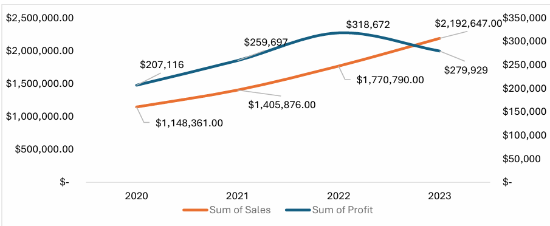

### **[S] SITUATION**

The organization achieved a cumulative revenue of **$6.52M** over the 2020–2023 period with a total net profit of **$1,065,414**. While annual sales volume grew from $1.14M to $2.19M, the Profit Margin plummeted from 18.0% in 2022 to 12.8% in 2023, indicating a severe decline in operational efficiency.

### **[T] TASK**
I performed a profitability audit of our transaction history over the past year to isolate the cause of the margin dip in 2023 to identify the relationship between discounting strategies and volume growth.

### **[A] ACTION**
•	**Transactional Multi-Layer Analysis:** I performed a multi layered analysis using Pivot Tables to combine columns like sales, discount and profits across all 51290 orders to see how discounts affect categories.
•	**Categorical Auditing:** I Isolated the Home and Accessories category to determine that its  net contribution is a negative value of **$ -57,187** compared to the other segments.

### **[R] RESULTS**

  

• Growth–profit divergence: Sales hit a four-year high of $2.19M in 2023 (+24%), but profit fell 12% ($318.7K to $279.9K) and margin dropped from 18.0% to 12.8%.

• Source of the decline: Body care explains about 79% of the $38.7K profit drop (margin 24.2% to 16.8%), followed by Make up (15%). Home & Accessories explains only about 5%.

• Home & Accessories: loss-making every year ($-57,187 total, -4.6% margin), a persistent drag but not the cause of the 2023 dip. Its margin is +10% on undiscounted orders.

• Deep discounts destroy margin: orders discounted over 30% ran at -15.6% (30-50%) and -32.3% (50%+) margin, versus +31.7% undiscounted. They made up 21% of sales and lost about $296K.

• No measurable volume benefit: the correlation between discount and quantity is near zero in every year (-0.002 to 0.004).

Recommendation: cap discounts at 30% across all categories and test whether this recovers margin in Body care and Make up, and review Home & Accessories costs separately.

Data note: the dataset appears to be a relabelled public sample (order IDs show 2012-2015 while dates show 2020-2023, and products don't match subcategories), so findings demonstrate method, not real-world conclusions. Source: [add name/link if you know it].
